<!-- ───────────────────────────────────────────────
     README · perfil de GitHub · Edwin Santiago
     Reemplaza TU_USUARIO, TU_LINKEDIN, TU_EMAIL y
     USUARIO_EFRAIN antes de publicar.
──────────────────────────────────────────────── -->

<div align="center">

<picture>
  <source media="(prefers-color-scheme: dark)" srcset="./assets/banner-dark.svg">
  <source media="(prefers-color-scheme: light)" srcset="./assets/banner-light.svg">
  
</picture>

<br/><br/>


</div>

<br/>

### `01` &nbsp; whoami

```js
const ed = {
  ubicacion:   "Colombia",
  rol:         "Full Stack Developer — en construcción, en público",
  formacion:   ["Ingeniería de Sistemas · CUL",
                "Maestría en Transformación Digital para la Educación"],
  frontend:    ["JavaScript", "React", "Next.js"],
  backend:     ["Node.js", "FastAPI", "PostgreSQL"],
  fuerte:      "el frontend: interfaces que se sienten bien",
  diferencial: "seguridad web desde el diseño (OWASP Top 10)",
  manifiesto:  "si no está en producción, no existe",
};
```

<br/>

### `02` &nbsp; stack

<sub>`// frontend`</sub>


<sub>`// backend & data`</sub>


<sub>`// en el radar`</sub>


<sub>`// workflow`</sub>


<br/>

### `03` &nbsp; proyectos

| | proyecto | qué resuelve | capa | stack |
|:-:|:--|:--|:-:|:--|
| ◉ | **[Software-GMK](https://github.com/TU_USUARIO/Software-GMK)** | Escáner de vulnerabilidades web para pymes colombianas, basado en OWASP Top 10. En equipo. | `full stack` | `Next.js` `FastAPI` `Docker` |
| ◉ | **Cardio Centro** | Sitio web para una institución de salud. Proyecto con cliente real. | `front` | `Next.js` `Headless CMS` |
| ◐ | **[CaféLab](https://github.com/TU_USUARIO/cafelab)** | Landing page con UI generada desde datos, toggle mensual/anual y FAQ con event delegation. | `front` | `HTML` `CSS` `JS` |
| ◐ | **[Product Card Renderer](https://github.com/TU_USUARIO/product-card-renderer)** | Componentes renderizados desde un array: destructuring, spread, `.map()` y módulos ES con Vite. | `front` | `JS` `Vite` |

<sub>◉ entregado &nbsp;·&nbsp; ◐ en construcción</sub>

<br/>

### `04` &nbsp; ahora mismo

```diff
+ dominando   JavaScript moderno · ES modules · async/await
+ shipeando   CaféLab → Product Card Renderer → GitHub Pages
! siguiente   React → TypeScript → Next.js → Node.js + APIs REST
! integrando  desarrollo asistido por IA en mi flujo de trabajo
! meta        full stack, listo para prácticas · dic 2026
```

<br/>

### `05` &nbsp; conexión

<a href="https://linkedin.com/in/TU_LINKEDIN"></a>
<a href="mailto:TU_EMAIL"></a>
<a href="https://TU_USUARIO.github.io"></a>

<br/><br/>

<div align="center">
<sub><code>diseña con intención · construye seguro · haz deploy</code></sub>
</div>
